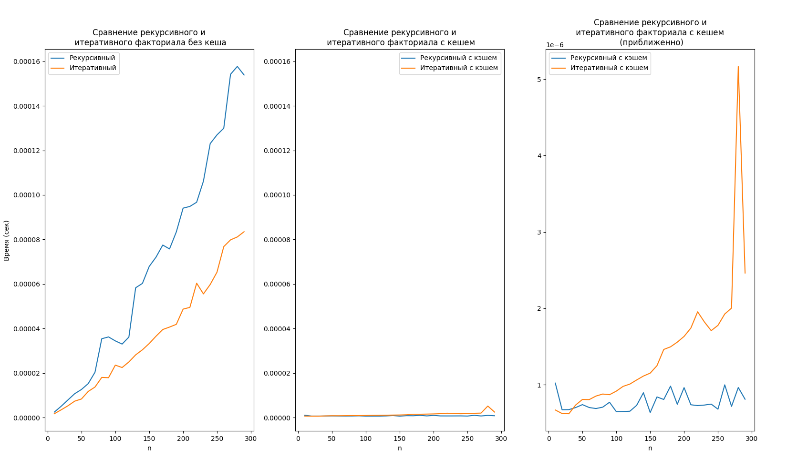

### Лабораторная работа 4
Я сделал три графика: на первом сравнивается выполнение факториала без кэша, а на втором и третьем сравнивается выполнение факториала с lru кэшированием (разница лишь в масштабе). 

Ожидаемо, на больших числах с кэшем рекурсивный алгоритм работает куда быстрее, чем итеративный. Однако, что было неожиданно, так это то, что кэширование разительно влияет на итеративный факториал (пусть и недостаточно, чтобы обогнать рекурсивный). Кэширование ускоряет итеративный факториал в тысячи раз.

На данный момент я не могу объяснить, почему кэширование так влияет на итеративный алгоритм. 

*выполнена Чичериным Александром, P3121*
